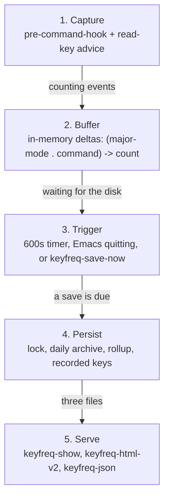
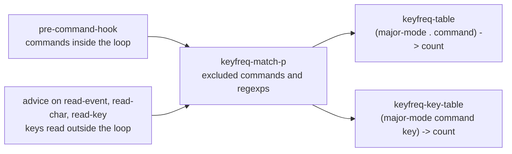
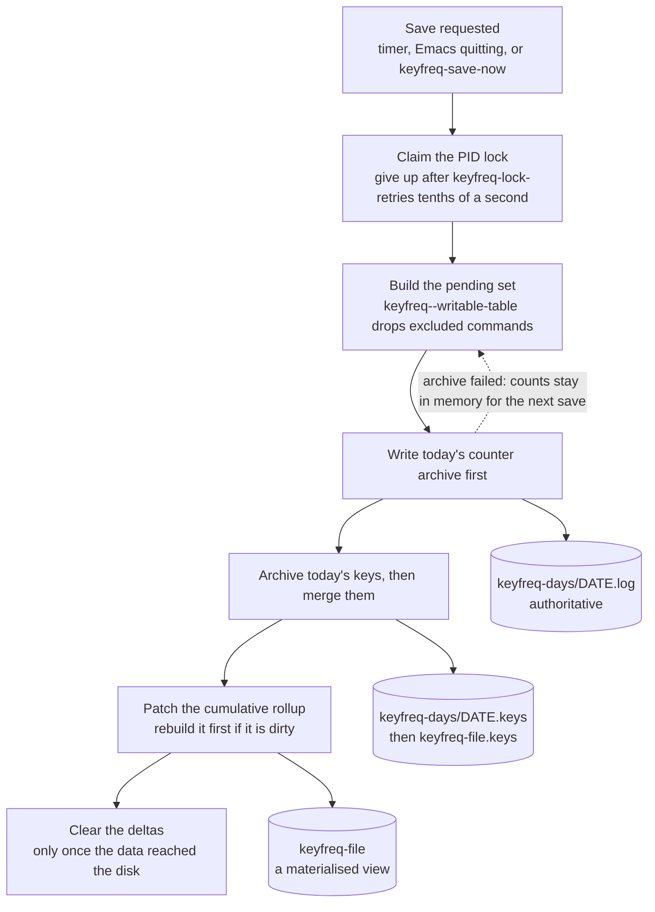
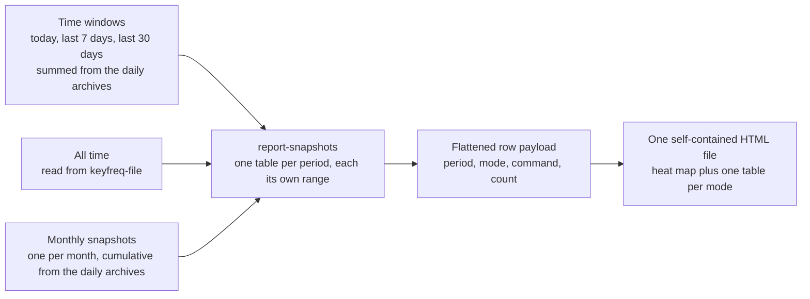
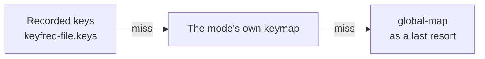

# Keyfreq fork

## About

This is a fork of [`keyfreq`](https://github.com/dacap/keyfreq), which counts how
often you run each Emacs command.  The fork keeps the statistics file small and
diffable, and rebuilds the HTML report around an interactive keyboard heat map.

Compared with upstream:

| | upstream | this fork |
| --- | --- | --- |
| saving | regenerates the whole file on every save | patches counters in place |
| statistics file | churns on every save | only changed lines change |
| report | one table per mode, stacked | one table at a time, chosen from a menu |
| heat map | one static canvas per mode | a single interactive canvas |
| shortcuts | resolved in the global keymap | resolved in each mode's own keymap |
| keys | resolved after the fact | recorded at press time, in a side file |
| time | cumulative only | today / 7 days / 30 days / one period per year, from the archives |


## The report

`M-x keyfreq-html-v2` writes a **single self-contained HTML file** -- the
stylesheet and the script are inlined, so the report can be moved, mailed or
committed and still works.  It opens the file in your browser; with a prefix
argument (`C-u`) it asks where to save instead of using a temporary file.

### Keyboard heat map

One canvas and a row of menus, with nothing else on the page:

* **Mode** -- `All major modes` or any single mode.  It drives the heat map
  *and* the table below it, so choosing `org-mode` shows org-mode's keys and
  org-mode's commands together.
* **Scale** -- `sqrt` (default), `linear` or `log`.  Command usage spans four
  orders of magnitude; a linear scale leaves almost every key blank.
* **Period** -- the menu runs from the widest window to the narrowest and then
  back into history: `All time` (the default), `Today`, `Last 7 days`, `Last 30
  days`, this year, and the older years newest first.  Each holds its own
  range, so the years add up to `All time`.  Months are part of the year they
  fall in and are never offered on their own.
* **Hover** -- shows the key, the number of presses and its share.
* **Key caps** -- drawn the way a MacBook Air prints them: the shifted symbol
  above the base one (`:` over `;`, `!` over `1`), letters in upper case, and
  the Apple glyphs `⌃` `⌥` `⌘` `⇧` `⇥` `⇪` `⌫` `↩` for Control, Option,
  Command, Shift, Tab, Caps Lock, Delete and Return.  Both legends of a cap are the same physical
  key, so their presses are added together and either one can be hovered or
  clicked.
* **Click** -- focuses a key: it is outlined, the keys it is used with (a
  modifier with the keys it modifies, and the keys of a multi-key sequence)
  keep their heat, every other key fades to a flat grey so the map keeps its
  shape, and the table keeps only the commands that use it.  The status line
  switches to that key -- its presses, its share of the selection and how many
  commands use it.  Click the chip, press `Escape` or click the key again to
  clear it.
* **Modifiers** -- `C-`, `M-`, `S-`, `s-` and `A-` light the Control, Option,
  Shift and Command keys; `s-` is Super (Command), not the letter `s`, and
  names like `<return>` or `<space>` are matched to their key caps.

Heat is a single accent ramp over a neutral key cap rather than a rainbow: a
rainbow invents banding that is not in the data.  The canvas follows
`prefers-color-scheme` and scales with `devicePixelRatio`.

### The table

Below the map there is exactly one table -- the selected mode -- with
`Times`, `%`, `Command` and `Shortcut` columns.  Every column header sorts, and
clicking it again reverses the order.  Commands with no key binding sort last.

Only the selected table is rendered: the other modes stay in the document (so
the report still reads without JavaScript) but are hidden, and they are rebuilt
lazily when you pick them.

### Shortcuts are resolved per mode

Upstream resolved every shortcut against the currently active keymaps, in
practice `global-map`, so any command bound only in a major mode's keymap showed
no key at all.

The report now resolves each mode/command pair in that mode's own
`<mode>-map`, and:

* drops `menu-bar` / `tool-bar` / `tab-bar` / `mode-line` / mouse pseudo
  bindings -- they are not keystrokes;
* credits only the **first** real binding of a command.  `keyfreq` counts
  commands, so counting a press once per binding would multiply it;
* skips unprintable key ranges, so the file is always valid UTF-8.

Resolving is still a guess, though: a command with two bindings gets one of
them, and every typed character is the single command
`self-insert-command`, so on its own it cannot split the character area.
Recording the key at press time -- the next section -- fixes both.

### Recorded keys

With `keyfreq-record-keys` (the default) keyfreq also stores the key
sequence that actually invoked each command, taken from
`this-command-keys` at the moment it runs, in a side file
(`<keyfreq-file>.keys`):

``` elisp
(((org-mode . self-insert-command) . 100)     ; the counter, as always
((org-mode self-insert-command "a") . 60)     ; the side file
((org-mode self-insert-command "b") . 40)
((org-mode next-line "C-n") . 10)
((org-mode next-line "<down>") . 5)
```

The report draws the recorded keys when it has them and falls back to
resolving the command for older counts, so both are visible at once and
nothing has to be migrated.  Two things that were impossible become plain
facts: typed characters get their own keys, and a command bound twice
contributes to each binding by its real share.  The side file is patched in
place and grows one line per (mode, command, key) used.

Recorded shortcuts embedded in the HTML report use JSON pairs, so key names
containing punctuation remain unambiguous.  Reports generated by older
versions with pipe-delimited shortcut metadata are still readable.

The keys are archived **one file per day**, next to the counter archive of
the same day, so every period draws the keys that were really pressed during
it: `Last 7 days` is seven days of keys, not the all-time split scaled down.
A day archived before `keyfreq-record-keys` was turned on has no key file,
and that period falls back to the old behaviour -- the all-time proportions
applied to its counts:

``` elisp
((org-mode . next-line) . 10)          ; the counter, as always
((org-mode next-line "C-n") . 6)       ; the day's key archive
((org-mode next-line "<down>") . 4)
```

Only presses made after this version was installed have a key file, so a
fresh log is not comparable with an old one -- the old periods still borrow
the all-time split.

### Keys that never run a command

A command loop only sees commands, so some keys were invisible: the
answers to `y-or-n-p', the per-hit keys of `query-replace', and anything
else read with `read-event' / `read-char' / `read-key' while a command is
running.  `keyfreq-record-prompts' (the default) advises those three
functions and counts what they return:

* they are counted under the pseudo command `keyfreq-prompt', because no
  real command runs for them -- add that name to
  `keyfreq-excluded-commands' to hide the row again;
* they enter the same key file, so the heat map shows `y`, `n` and `q`
  for a replacement session.

What still cannot be recorded, at this level:

* `ESC` on its own.  Emacs maps it to `meta-prefix-char`, so it is a
  prefix, not a command: nothing runs and nothing is counted.  `ESC` followed
  by a key arrives as `M-<key>` (the heat map lights the Option key), and the
  ESC cap itself never lights up.
* other bare prefixes (`C-x`, `C-c`, `C-h`, ...), and any key that aborts
  instead of running a command;
* keys that go to a subprocess, as in `vterm` or `ansi-term`;
* keys pressed in other applications.

> The figures below are the author's own usage, not a property of the patch.
> On that log -- 5,028 mode/command pairs over 140 modes -- `org-mode` resolved
> **57.7%** of its presses to a key with the upstream code and **88.1%** with
> the fork.  `org-return` alone carried 57,708 presses there and displayed no
> key, although it is `RET`.  Your own split will differ; only the mechanism
> is general.

## Data flow

A keypress travels through five stages before it becomes a colour on a key cap.
The diagrams below walk the same pipeline at decreasing zoom: the whole trip,
the capture stage, the write path, and the read path.

### The whole trip



### Capturing: two entrances, two tables

The command loop only ever sees commands, never the keys a command reads while
it is running, so counting has two entrances. They also differ in *when* they
filter: command counters are filtered as they are recorded, key counters are
filtered at save time. That asymmetry is deliberate -- it is what keeps the two
files on the same terms.



One subtlety that is easy to misread: the pairing is one step out of phase. The
hook records the key belonging to the *previous* command -- `keyfreq--last-keys`
paired with `real-last-command` -- before it updates them, because the key is
known before a command runs while the command is only certain once it has run.

### Saving: one authoritative copy, one derived view

The order matters. The daily archive is authoritative and the cumulative file
is a view that can always be regenerated from it, which is why a failed archive
write keeps the counts but a failed rollup write does not.



A mandatory save waits at most five seconds for the lock and then leaves the
counts in memory, so quitting Emacs can never hang on it. Both writers go
through a temporary file and rename it into place, and a file that no longer
parses is copied to `keyfreq-file.corrupt-<timestamp>` before its readable
entries are salvaged.

### Reading: three notions of time



Every snapshot holds the counts of **its own range**, not a running total: 2023
is what 2023 added, not the picture as it stood at the end of 2023.  The
periods are therefore disjoint and add up to `All time`, which is the point of
layering the archives the way the previous section describes.

A year is one period whether its data lives in a year archive or in the months
and days that fall in it, and a month is never offered separately, so nothing
can be counted twice.  Nothing outside the keyfreq data files is read -- in
particular the report never asks git for anything.

Shortcuts are attributed in this order, cheapest and most truthful first:



## Saving behaviour

See [Data flow](#data-flow) for a one-screen view of this section.

`keyfreq` keeps its statistics in `keyfreq-file` (by default `~/.emacs.keyfreq`),
one `((major-mode . command) . count)` entry per line.

Saving used to regenerate the whole file from the in-memory hash table, and the
writer emitted entries in reverse order, so every save rewrote every line: a log
of N entries produced a diff of roughly N lines touched, whatever you did in
between.

A save now patches the file in place:

* an entry that already exists keeps its line and only its counter is rewritten;
* a command that is not in the file yet is appended as a new line, right before
  the closing parenthesis;
* every other byte is untouched, so `git diff` shows only what really changed.

The writer is also safer: it writes through a temporary file and renames it into
place, it never drops the in-memory deltas unless the data reached the disk, and
a truncated or damaged file is copied to `keyfreq-file.corrupt-<timestamp>`
before the readable entries are salvaged, instead of wiping the history.  The
same applies to the recorded-keys side file.

`M-x keyfreq-reset` clears everything the statistics consist of: the rollup,
the recorded keys and the whole daily-archive directory, plus both in-memory
tables.  It deletes nothing when another Emacs holds the lock.

One caveat on the lock: it is a local PID file.  It keeps two Emacsen on the
*same machine* from clobbering each other; a home directory shared over the
network with another machine is not covered, since a lock held there looks
stale locally and is removed.  A mandatory save waits at most
`keyfreq-lock-retries` tenths of a second for the lock and then leaves the new
counts in memory for the next autosave, so quitting Emacs never hangs on it.

### One file per day

Cumulative counters can only answer "since the beginning", so the fork also
writes one small file per day:

```
<keyfreq-file>                     cumulative rollup
<keyfreq-file>.keys                the recorded keys (see above)
<keyfreq-days>/.baseline.log       the rollup before the split
<keyfreq-days>/2026-10-18.log      today's deltas
<keyfreq-days>/2026-10-18.keys     today's recorded keys
<keyfreq-days>/2026-10-17.log      yesterday, frozen
<keyfreq-days>/2026-10-17.keys     yesterday's keys, frozen
<keyfreq-days>/2026-09.log         September, once compacted
<keyfreq-days>/2026-09.keys        September's keys, once compacted
<keyfreq-days>/2023.log            2023, once compacted further
<keyfreq-days>/2023.keys           2023's keys, once compacted further
```

The counter and the key archive of a day are written by the same save, so a
period always reads two files that agree with each other.

`<keyfreq-days>` is a `keyfreq-days` directory next to `keyfreq-file` unless
`keyfreq-daily-directory` says otherwise.

The daily archives are authoritative; `keyfreq-file` is a materialised view that
`M-x keyfreq-rebuild-rollup` can regenerate from the baseline plus every daily
file.  A failed archive write keeps the counters for the next save; a failed
rollup write still clears them (they are safely archived) and rebuilds the
rollup on the next save.

Cost of reading a window, measured on a log with about 5,000 entries (it grows
with the number of entries, not with this particular history):

| window | files | parse |
| --- | --- | --- |
| today | 1 | 0.6 ms |
| last 7 days | 7 | 13 ms |
| last 30 days | 30 | 16 ms |
| all time | 1 (`keyfreq-file`) | 14 ms |

Each save touches only `keyfreq-log` and today's file, so the archives stay
friendly to version control.

### Compaction

One file per day means the directory only ever grows.  Two thresholds thin it
out, coarse at the old end and fine at the recent one:

```
last 30 days           one file per day    2026-10-18.log
older, up to a year    one file per month  2026-09.log
older still            one file per year   2023.log
```

Set `keyfreq-daily-retention` and the days older than it are folded into one
file per month; set `keyfreq-monthly-retention` and the months older than it
are folded into one file per year.  Either happens once a day, while saving;
`M-x keyfreq-compact-archives` does both on demand, and a prefix argument
overrides the number of days.

A coarser archive carries exactly the counts of the finer ones it replaces, so
no period loses anything: `Last 30 days` still reads day files, a year still
reads the months and days that fall in it, and `M-x keyfreq-rebuild-rollup`
reads all three.  What changes is the resolution of the older end of the
history, and the number of files in the directory.

`keyfreq-daily-retention` has to be at least 30: below that, the `Last 30 days`
view would lose the day files it reads.

Compaction is safe to interrupt: the files are moved to a staging directory
before they are added up, and the coarser archive is written from that staging
area alone, so finishing an interrupted run produces the same numbers rather
than twice the counts.

## Drawbacks

1. The keyboard layout is **hardcoded** (Apple).  Feeding it a JSON layout from
   [keyboard-layout-editor.com](http://www.keyboard-layout-editor.com/) would
   generalise it.
2. Counters collected before `keyfreq-record-keys` was enabled are still a map
   of **hotkeys**, not of typing: the key is resolved afterwards, a command with
   two bindings is drawn on its first one, and typed characters collapse into
   the single `self-insert-command` counter.  The recorded keys fill that gap
   only for presses made after the setting was turned on, so a fresh log is not
   comparable with an old one.
3. Those old counters are what the numbers below describe.  On the author's log
   roughly 49% of the recorded presses are mouse events, 22% are typing
   collapsed into `self-insert-command`, 10% resolve to no binding at all, and
   only about 29% land on a physical key.  Recording the keys moves the typing
   share onto real key caps, but the mouse share stays: those proportions depend
   entirely on how you use Emacs, so treat them as an illustration, not as a
   normalisation.
4. Auto-generated key descriptions can be surprising: in `dired`,
   `revert-buffer` is `<menu-bar> <file> <revert-buffer>` when you actually press
   `g`.  Pseudo bindings are now filtered out, so the row simply shows no key.
5. The month and year periods reach only as far back as the archives do: months
   before `keyfreq-daily-archive' was turned on are simply absent, and the
   baseline, which predates every archive, is counted into the earliest period
   there is.  The old git-history periods reached further back but needed the
   log to be committed.
6. `keyfreq-html` is now the same report as `keyfreq-html-v2` (kept for
   compatibility); there is no longer a separate plain-table page.
7. JavaScript is required for the heat map and for the single-table view.  With
   it disabled the report still lists every table, just as one long page.

## Installation

### Manually

Download this repository to a folder and add this folder to your `load-path`.

``` elisp
(require 'keyfreq)
(keyfreq-mode 1)
(keyfreq-autosave-mode 1)
```

An additional setting is required with this fork: the location of the keyfreq
folder, which holds the inlined `style.css` and `script.js`:

``` elisp
(setq keyfreq-folder "<keyfreq-installation-folder>")
```

### With use-package and quelpa

``` elisp
(use-package keyfreq
  :quelpa ((keyfreq :fetcher github :repo "KirmTwinty/keyfreq") :upgrade t :ensure t)
  :bind (("C-c k" . keyfreq-html-v2))
  :config
  (setq keyfreq-folder "~/.emacs.d/quelpa/build/keyfreq/")
  (keyfreq-mode 1)
  (keyfreq-autosave-mode 1)
  (setq keyfreq-excluded-commands
        '(self-insert-command
          mwheel-scroll))
  ;; To exclude commands:
  ;; (setq keyfreq-excluded-commands
  ;;     '(self-insert-command
  ;;       forward-char
  ;;       backward-char
  ;;       previous-line
  ;;       next-line))
  )
```

## How to use

| Command | What it does |
| --- | --- |
| `keyfreq-show` | How many times each command ran, in a buffer. |
| `keyfreq-html-v2` | The interactive report.  `C-u` asks where to save it. |
| `keyfreq-html` | Same report, kept for compatibility. |
| `keyfreq-json` | The raw statistics as JSON. |
| `keyfreq-sort-file` | One-off normalisation: sort the statistics file by key. |
| `keyfreq-rebuild-rollup` | Regenerate `keyfreq-file` from the baseline, the daily archives and the month archives. |
| `keyfreq-compact-archives` | Fold days older than `keyfreq-daily-retention` into months, and months older than `keyfreq-monthly-retention` into years.  A prefix argument overrides the number of days. |
| `keyfreq-reset` | Delete all statistics: the data file, the recorded keys and the daily archives. |
| `keyfreq-save-now` | Save the counters immediately. |
| `keyfreq-where-is` | Keys a command is bound to; pass a keymap to see a mode's own bindings. |

## Settings

| Setting | Default | Meaning |
| --- | --- | --- |
| `keyfreq-file` | `~/.emacs.keyfreq` | The cumulative statistics file. |
| `keyfreq-file-lock` | `<file>.lock` | Lock file, so two Emacsen do not clobber each other. |
| `keyfreq-incremental-save` | `t` | `nil` regenerates the whole file (the old behaviour). |
| `keyfreq-daily-archive` | `t` | Keep one file per day; `nil` writes no directory at all. |
| `keyfreq-daily-directory` | next to `keyfreq-file` | Where the daily archives live. |
| `keyfreq-daily-retention` | `nil` | Days of daily archives to keep; older ones are folded into a file per month.  `nil` keeps every day.  At least 30. |
| `keyfreq-monthly-retention` | `nil` | Months of monthly archives to keep; older ones are folded into a file per year.  `nil` keeps every month. |
| `keyfreq-html-history` | `t` | Offer one period per year, built from the archives.  Each holds its own range, so they add up to All time.  `nil` keeps only Today / 7 days / 30 days / All time. |
| `keyfreq-coding-system` | `nil` | Coding system of the file; `nil` detects it, so an existing file keeps its encoding. |
| `keyfreq-record-keys` | `t` | Record the key sequence that invoked each command, in `<keyfreq-file>.keys`. |
| `keyfreq-record-prompts` | `t` | Also count keys read outside the command loop (`y-or-n-p`, `query-replace`), under `keyfreq-prompt`. |
| `keyfreq-key-file` | `nil` | Where the recorded keys live; `nil` derives it from `keyfreq-file`. |
| `keyfreq-excluded-commands` | `nil` | Commands that are never counted (noise such as `mouse-*`). |
| `keyfreq-excluded-regexp` | `nil` | Regexps of commands that are never counted. |
| `keyfreq-autosave-timeout` | `600` | Seconds between automatic saves. |
| `keyfreq-lock-retries` | `50` | Tenths of a second a mandatory save waits for the lock before giving up; the counts stay in memory for the next autosave. |

## Running the tests

``` sh
emacs --batch -l test/keyfreq-tests.el        # persistence, 160 assertions
emacs --batch -l test/keyfreq-html-tests.el   # the report, 86 assertions
```

Both suites build their own fixtures in a temporary directory and never touch
your real `keyfreq-file`.

## Changes in this fork

What this fork adds on top of upstream 1.7, newest first.  The source file
carries no version notes of its own, so this list is where the differences
live.

### Periods are disjoint, and the menu starts at All time

A period now holds what **that range added**, not a running total, so the
periods add up to `All time`: 2023 is what 2023 added, not the picture as it
stood at the end of 2023.  The menu runs `All time`, `Today`, `Last 7 days`,
`Last 30 days`, the current year, then the older years newest first.  A month is
part of its year and is never a period of its own.

### The archive directory is layered

Days for the last month, months for the current year, one file per year for
everything before:

```
<keyfreq-days>/2022.log            a year, once its months are folded in
<keyfreq-days>/2026-10.log         a month, once its days are folded in
<keyfreq-days>/2026-10-26.log      a day, still being written
```

`keyfreq-daily-retention` and `keyfreq-monthly-retention` fold the older end on
their own, once a day while saving, and `M-x keyfreq-compact-archives` does it
on demand.  A coarser archive carries exactly what the finer ones held, so
`Last 30 days`, the year periods and `keyfreq-rebuild-rollup` all read every
layer alike.  Compaction is safe to interrupt: the files are moved to a staging
directory before they are added up, so finishing an interrupted run yields the
same counts rather than twice the counts.

### The report reads nothing outside its own data files

The period menu no longer reads the git history of `keyfreq-file`.  Every period
is built from the archives above, so nothing outside the keyfreq data directory
is consulted, and the history reaches exactly as far back as the archives do.

### Recorded keys are archived one file per day

Keys are written next to the counter archives, `2026-10-26.keys` beside
`2026-10-26.log`, so a period draws the keys really pressed during it instead of
borrowing the all-time split.  A period whose keys were never archived falls back
to the old behaviour, and a key archive that fails to write keeps its deltas in
memory so no day of keys is silently dropped.

### Saving and robustness (earlier changes)

* Save in place: a key that is already in the file keeps its line and only its
  counter is rewritten, so version control shows only the lines that really
  changed.  The whole file is regenerated only when it cannot be parsed.
* Writes go through a temporary file and an atomic rename, and a failed write
  never corrupts the in-memory table.
* `keyfreq-sort-file` normalises the file on demand.
* A mandatory save gives up on a live lock after `keyfreq-lock-retries` tenths
  of a second instead of hanging Emacs on quit.
* `keyfreq-reset` also deletes the recorded keys and the daily archives, and no
  longer clears the tables when it cannot lock.  Turning `keyfreq-mode` off
  removes the prompt advice.
* A damaged keys file is backed up and rewritten instead of failing on every
  later save.
* `keyfreq-excluded-regexp` has its proper custom type.
* The file is lexically bound and byte-compiles without warnings.
