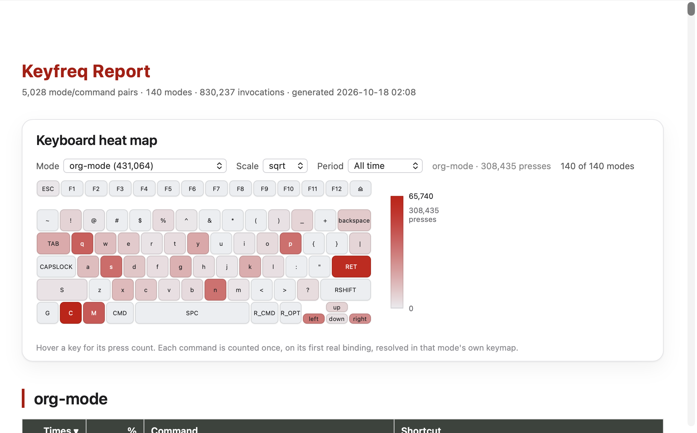

# Keyfreq fork

## About

This is a fork of [`keyfreq`](https://github.com/dacap/keyfreq), which counts how
often you run each Emacs command.  The fork keeps the statistics file small and
diffable, and rebuilds the HTML report around an interactive keyboard heat map.

Compared with upstream:

| | upstream | this fork |
| --- | --- | --- |
| saving | regenerates the whole file on every save | patches counters in place |
| statistics file | churns on every save | only changed lines change |
| report | one table per mode, stacked | one table at a time, chosen from a menu |
| heat map | one static canvas per mode | a single interactive canvas |
| shortcuts | resolved in the global keymap | resolved in each mode's own keymap |
| time | cumulative only | today / 7 days / 30 days / git snapshots |



## The report

`M-x keyfreq-html-v2` writes a **single self-contained HTML file** -- the
stylesheet and the script are inlined, so the report can be moved, mailed or
committed and still works.  It opens the file in your browser; with a prefix
argument (`C-u`) it asks where to save instead of using a temporary file.

### Keyboard heat map

One canvas, four controls and no page-level clutter:

* **Mode** -- `All major modes` or any single mode.  It drives the heat map
  *and* the table below it, so choosing `org-mode` shows org-mode's keys and
  org-mode's commands together.
* **Scale** -- `sqrt` (default), `linear` or `log`.  Command usage spans four
  orders of magnitude; a linear scale leaves almost every key blank.
* **Period** -- `Today`, `Last 7 days`, `Last 30 days`, one entry per month
  found in the git history of `keyfreq-file`, and `All time` (the default).
* **Hover** -- shows the key, the number of presses and its share.

Heat is a single accent ramp over a neutral key cap rather than a rainbow: a
rainbow invents banding that is not in the data.  The canvas follows
`prefers-color-scheme` and scales with `devicePixelRatio`.

### The table

Below the map there is exactly one table -- the selected mode -- with
`Times`, `%`, `Command` and `Shortcut` columns.  Every column header sorts, and
clicking it again reverses the order.  Commands with no key binding sort last.

Only the selected table is rendered: the other 140 stay in the document (so the
report still reads without JavaScript) but are hidden, and they are rebuilt
lazily when you pick them.

### Shortcuts are resolved per mode

Upstream resolved every shortcut against the currently active keymaps, in
practice `global-map`, so any command bound only in a major mode's keymap showed
no key at all.  For `org-mode` that hid **42% of all key presses**:
`org-return` (57,708 presses, the third most used command) displayed nothing
even though it is `RET`.

The report now resolves each mode/command pair in that mode's own
`<mode>-map`, and:

* drops `menu-bar` / `tool-bar` / `tab-bar` / `mode-line` / mouse pseudo
  bindings -- they are not keystrokes;
* credits only the **first** real binding of a command.  `keyfreq` counts
  commands, so counting a press once per binding would multiply it;
* skips unprintable key ranges, so the file is always valid UTF-8.

Coverage for `org-mode` went from **57.7% to 88.1%** of presses.

## Saving behaviour

`keyfreq` keeps its statistics in `keyfreq-file` (by default `~/.emacs.keyfreq`),
one `((major-mode . command) . count)` entry per line.

Saving used to regenerate the whole file from the in-memory hash table, and the
writer emitted entries in reverse order, so every save rewrote every line -- a
5000-entry log changed by about 10,000 lines per save regardless of what you did.

A save now patches the file in place:

* an entry that already exists keeps its line and only its counter is rewritten;
* a command that is not in the file yet is appended as a new line, right before
  the closing parenthesis;
* every other byte is untouched, so `git diff` shows only what really changed.

The writer is also safer: it writes through a temporary file and renames it into
place, it never drops the in-memory deltas unless the data reached the disk, and
a truncated or damaged file is copied to `keyfreq-file.corrupt-<timestamp>`
before the readable entries are salvaged, instead of wiping the history.

### One file per day

Cumulative counters can only answer "since the beginning", so the fork also
writes one small file per day:

```
~/.emacs.d/assets/keyfreq-log                  cumulative rollup
~/.emacs.d/assets/keyfreq-days/.baseline.log   the rollup before the split
~/.emacs.d/assets/keyfreq-days/2026-10-18.log  today's deltas
~/.emacs.d/assets/keyfreq-days/2026-10-17.log  yesterday, frozen
```

The daily archives are authoritative; `keyfreq-file` is a materialised view that
`M-x keyfreq-rebuild-rollup` can regenerate from the baseline plus every daily
file.  A failed archive write keeps the counters for the next save; a failed
rollup write still clears them (they are safely archived) and rebuilds the
rollup on the next save.

Cost of reading a window, measured on a log this size:

| window | files | parse |
| --- | --- | --- |
| today | 1 | 0.6 ms |
| last 7 days | 7 | 13 ms |
| last 30 days | 30 | 16 ms |
| all time | 1 (`keyfreq-file`) | 14 ms |

Each save touches only `keyfreq-log` and today's file, so the archives stay
friendly to version control.

## Drawbacks

1. The keyboard layout is **hardcoded** (Apple).  Feeding it a JSON layout from
   [keyboard-layout-editor.com](http://www.keyboard-layout-editor.com/) would
   generalise it.
2. `keyfreq` records the *command* you ran, not the keys you pressed.  The map is
   therefore a map of **hotkeys**, not of typing.  Measured on this log, of the
   recorded presses roughly 49% are mouse events, 22% are typing collapsed into
   the single `self-insert-command` counter, 10% resolve to no binding at all,
   and only about **29% land on a physical key**.  The character area can never
   be split per letter without recording `this-command-keys`.
3. A command with several bindings is drawn on its first one only.
4. Auto-generated key descriptions can be surprising: in `dired`,
   `revert-buffer` is `<menu-bar> <file> <revert-buffer>` when you actually press
   `g`.  Pseudo bindings are now filtered out, so the row simply shows no key.
5. The git-history periods depend on the log being committed: months with no
   commits, or counters that were reset by hand, are visible as such.
6. `keyfreq-html` is now the same report as `keyfreq-html-v2` (kept for
   compatibility); there is no longer a separate plain-table page.
7. JavaScript is required for the heat map and for the single-table view.  With
   it disabled the report still lists every table, just as one long page.

## Installation

### Manually

Download this repository to a folder and add this folder to your `load-path`.

``` elisp
(require 'keyfreq)
(keyfreq-mode 1)
(keyfreq-autosave-mode 1)
```

An additional setting is required with this fork: the location of the keyfreq
folder, which holds the inlined `style.css` and `script.js`:

``` elisp
(setq keyfreq-folder "<keyfreq-installation-folder>")
```

### With use-package and quelpa

``` elisp
(use-package keyfreq
  :quelpa ((keyfreq :fetcher github :repo "KirmTwinty/keyfreq") :upgrade t :ensure t)
  :bind (("C-c k" . keyfreq-html-v2))
  :config
  (setq keyfreq-folder "~/.emacs.d/quelpa/build/keyfreq/")
  (keyfreq-mode 1)
  (keyfreq-autosave-mode 1)
  (setq keyfreq-excluded-commands
        '(self-insert-command
          mwheel-scroll))
  ;; To exclude commands:
  ;; (setq keyfreq-excluded-commands
  ;;     '(self-insert-command
  ;;       forward-char
  ;;       backward-char
  ;;       previous-line
  ;;       next-line))
  )
```

## How to use

| Command | What it does |
| --- | --- |
| `keyfreq-show` | How many times each command ran, in a buffer. |
| `keyfreq-html-v2` | The interactive report.  `C-u` asks where to save it. |
| `keyfreq-html` | Same report, kept for compatibility. |
| `keyfreq-json` | The raw statistics as JSON. |
| `keyfreq-sort-file` | One-off normalisation: sort the statistics file by key. |
| `keyfreq-rebuild-rollup` | Regenerate `keyfreq-file` from the baseline and the daily archives. |
| `keyfreq-save-now` | Save the counters immediately. |
| `keyfreq-where-is` | Keys a command is bound to; pass a keymap to see a mode's own bindings. |

## Settings

| Setting | Default | Meaning |
| --- | --- | --- |
| `keyfreq-file` | `~/.emacs.keyfreq` | The cumulative statistics file. |
| `keyfreq-file-lock` | `<file>.lock` | Lock file, so two Emacsen do not clobber each other. |
| `keyfreq-incremental-save` | `t` | `nil` regenerates the whole file (the old behaviour). |
| `keyfreq-daily-archive` | `t` | Keep one file per day; `nil` writes no directory at all. |
| `keyfreq-daily-directory` | next to `keyfreq-file` | Where the daily archives live. |
| `keyfreq-html-history` | `t` | Read the git history for the period menu; `nil` skips it (and its ~2.3 s). |
| `keyfreq-coding-system` | `nil` | Coding system of the file; `nil` detects it, so an existing file keeps its encoding. |
| `keyfreq-excluded-commands` | `nil` | Commands that are never counted (noise such as `mouse-*`). |
| `keyfreq-excluded-regexp` | `nil` | Regexps of commands that are never counted. |
| `keyfreq-autosave-timeout` | `600` | Seconds between automatic saves. |

## Running the tests

``` sh
emacs --batch -l test/keyfreq-tests.el        # persistence, 51 assertions
emacs --batch -l test/keyfreq-html-tests.el   # the report, 59 assertions
```

Both suites build their own fixtures in a temporary directory and never touch
your real `keyfreq-file`.
